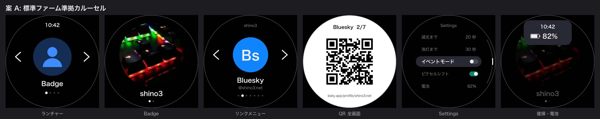
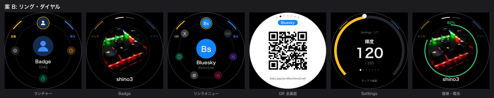
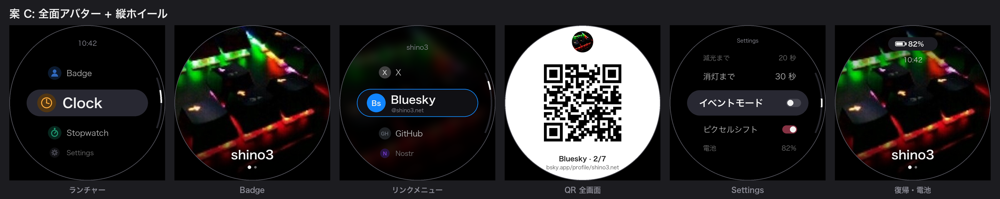

# 画面デザイン案(A / B / C)

M5Stack StopWatch(468×468、中心 (234,234)、可視半径 233)向けの 3 方向の案。
モックは `docs/design/render_mockups.py` で再生成できる(`.venv/bin/python docs/design/render_mockups.py`)。

- 一覧: [a/sheet.png](a/sheet.png)、[b/sheet.png](b/sheet.png)、[c/sheet.png](c/sheet.png)、比較 [compare.png](compare.png)
- 各案の画面: `launcher` / `badge` / `links` / `qr` / `settings` / `status`(復帰時・電池)の 6 枚。
- **モックのフォントは代用。** macOS のヒラギノ角ゴ W3 / W6 で描いている。実機は `lgfxJapanGothic_*`。仕様の「JG24」は `lgfxJapanGothic_24` の意味で、モックの文字サイズもその番号にそろえた。
- QR は格子模様の偽物。サイズ比は本物と同じ(V3 = 29 モジュール、8px、静止域 4 モジュール)。
- 傾き連動(IMU でアバターを動かす): 不採用(2026-11-23、実機で試して却下)。Badge はどの案も静止表示 + ピクセルシフト。

> **2026-11-23 の実機フィードバックで変更**: 案 B を採用して実装したが、リンク選択とランチャーのリング(円周に項目を並べる UI)は実機で操作しにくかった。どちらも中央の行が選択中の縦一覧(案 C のホイールに近い。ぼかし背景はなし)に置き換え、Settings も 1 画面 1 項目のゲージをやめてトグルとシークバーを並べた一覧にした。Badge、QR、ボタン表示(物理ボタンの内側の円弧と文字)は案 B のまま。実装は `src/list_wheel.*` と `src/settings_scene.*`。

## 共通の取り決め

| 項目 | 値 |
|---|---|
| 背景 | 黒 (0,0,0)。白べた塗りは QR 画面だけ |
| 文字色 | 主 (240,240,240)、副 (140,140,150)、無効 (60,60,68) |
| トラック(円弧の下地) | (38,38,44) |
| パネル(選択行・ダイアログ) | (40,40,50) |
| ピクセルシフト | 静止画は 1 分ごとに ±3px。画面全体(スプライトの置き位置)をずらす。円の縁から 10px 以内に要素を置かない |
| 使える横幅 | 高さ y で `2·sqrt(233² − (y−234)²)`。y=60 で 305、y=400 で 316、y=430 で 258 |

### QR(3 案共通の計算)

- ECC M、バイトモード。モジュール px は「(N + 8)·m ≤ 329」(円に内接する正方形の一辺 = 233·√2)を満たす最大の整数 m。
  - V2(25 モジュール)→ 9px、V3(29)→ 8px、V4(33)→ 8px(静止域込み 328px)、V5(37)→ 7px。
  - 例: `https://bsky.app/profile/shino3.net`(35 文字)は V3、8px、QR 本体 232px、静止域込み 296px、中心 (234,234)。
- 静止域込みの正方形の角は中心から 209px。円の内側に収まる。
- 輝度は `qr_brightness`(既定 255)。60 秒で Badge へ戻る。

### リンク種別のアイコン(3 案共通、プリミティブで描く)

公式ロゴは使わない。`fillCircle` の上に頭文字を `drawString`(中央揃え、`textdatum = middle_center`)。Web だけ地球儀を線で描く。

| kind | 頭文字 | 円の色 RGB | 文字色 |
|---|---|---|---|
| x | X | (235,235,235) | 黒 |
| bluesky | Bs | (17,133,254) | 白 |
| github | GH | (110,118,129) | 白 |
| nostr | N | (142,68,239) | 白 |
| instagram | IG | (225,48,108) | 白 |
| threads | @ | (200,200,200) | 黒 |
| web | 地球儀(円 + 縦楕円 + 横線 3 本) | (40,170,120) | 白 |
| 未知 | label の 1 文字目 | (90,90,100) | 白 |

- 頭文字のサイズは円の半径 r に対して 1 文字なら r、2 文字なら 0.78r 程度。JG フォントの段に丸める(r=88 → JG40 を `setTextSize(1.6)` か FreeSansBold24pt)。
- 選択されていない項目は「円 = 色 × 0.28、文字 = 色 × 0.9」の暗い版にする(黒の面積を増やし、選択を目立たせる)。

### アプリのアイコン(ランチャー、3 案共通、プリミティブ)

外接半径 s に対して:

| アプリ | 色 RGB | 形 |
|---|---|---|
| Badge | (64,140,255) | 頭 `fillCircle(cx, cy−0.25s, 0.26s)` + 胴 上半分の楕円(`fillEllipse` を下半分マスク、または `fillArc` 180°) |
| Clock | (255,170,60) | 輪 `drawCircle` 0.58s 太さ 0.11s(`fillArc` で太線) + 針 2 本 `drawWideLine` |
| Stopwatch | (40,200,150) | 輪 0.52s + 上の竜頭 `fillRoundRect` + 針 1 本(40°) |
| Settings | (150,150,170) | 歯 8 枚 `fillTriangle` ×2 ずつ + `fillCircle` 0.42s + 穴 0.18s を背景色で |

アイコン背景の円は「色 × 0.32」。

---

## 案 A: 標準ファーム準拠カルーセル



### (1) コンセプト

標準ファームの「1 ページ 1 項目、左右シェブロン、下にページドット」をランチャー以外にもそのまま使う。StopWatch の利用者は標準ファームの操作を一度覚えているので、説明なしで触れる。リンクメニューもランチャーと同じ形にして、覚える型を 1 つにする。円形はほとんど活かさず、上下中央に積む縦並びで済ませる。

### (2) 遷移と操作(標準ファームに「合わせる」)

```
            A+B 長押し(どこからでも)
                 │
[ランチャー] ──タップ──> [Badge] ──KEYA──> [リンク] ──タップ──> [QR]
   │                       ▲  A+B 短押し     │ ▲    A+B 短押し / タップ │
   └──タップ──> [Settings]  └────────────────┘ └────────────────────────┘
上端から下へスワイプ: 電池パネル(どの画面でも)
```

| 画面 | KEYA | KEYB | 左右スワイプ | タップ | 長押し | A+B |
|---|---|---|---|---|---|---|
| ランチャー | 前のアプリ | 次のアプリ | 前後 | アイコン: 起動 / シェブロン: 前後 | なし | なし |
| Badge | リンクメニュー | 次のプロファイル | プロファイル切替 | なし | イベントモード ON/OFF ダイアログ | ランチャー |
| リンク | 前のリンク | 次のリンク | 前後 | 中央: QR / シェブロン: 前後 | なし | 短: Badge / 長: ランチャー |
| QR | 前のリンク | 次のリンク | 前後 | リンクに戻る | なし | 短: リンク / 長: ランチャー |
| Settings | 上の行 | 下の行 | (上下スワイプで行移動) | 行: 値を変える(トグル / 段階を循環) | なし | 短長: ランチャー |

- 戻る操作は「A+B 短押しで 1 階層、長押しでランチャー」。画面上には出さない(標準ファームと同じ)。
- ダイアログは標準 Badge の「Edit / Cancel」と同じ形: 角丸パネル (40,40,50) 幅 330 高さ 150、中心 (234,234)、ピル 2 個(左 (20,224,176)、右 (100,100,120))。

### (3) レイアウト(アクセント = (20,224,176))

**ランチャー** [a/launcher.png](a/launcher.png)

| 要素 | 位置・大きさ | フォント / 色 |
|---|---|---|
| 時刻 | 中心 (234,50) | JG24、主 |
| アイコン背景 | `fillCircle(234,210,96)` | アプリ色 × 0.32 |
| アイコン | 中心 (234,210)、s=96 | アプリ色 |
| シェブロン | 頂点 (62,210) と (406,210)、腕 22px、太さ 5 の `drawWideLine` 2 本 | (240,240,240) |
| アプリ名 | 中心 (234,345) | JG32、主 |
| ページドット | y=392、間隔 20、選択 r=6 主 / 他 r=3.5 無効色 | |
| タップ判定 | アイコン: 中心から半径 110 以内。シェブロン: x<110 / x>358 かつ |y−210|<60 | |

**Badge** [a/badge.png](a/badge.png)

| 要素 | 位置・大きさ | フォント / 色 |
|---|---|---|
| アバター | 320×320 JPEG、中心 (234,200)(左上 74,40) | |
| 表示名 | 中心 (234,395)。幅 300 を超えたら JG28 に落とす | JG32、主 |
| プロファイルドット | y=434、間隔 18、選択 r=5 / 他 r=3.5 | |

アバター 384 の現行実装から 320 に縮める(名前とドットを円の内側に収めるため)。

**リンクメニュー** [a/links.png](a/links.png)

| 要素 | 位置・大きさ | フォント / 色 |
|---|---|---|
| プロファイル名 | 中心 (234,52) | JG20、副 |
| アイコン | `fillCircle(234,200,88)` + 頭文字 | 種別色 |
| シェブロン | (62,200)、(406,200) | ランチャーと同じ |
| 種別名 | 中心 (234,328) | JG32、主 |
| ハンドル | 中心 (234,366)。長い npub は `前 10 文字…後 5 文字` | JG20、副 |
| ページドット | y=406、件数ぶん(7 件で幅 120) | |

**QR** [a/qr.png](a/qr.png): 全面 `fillCircle(234,234,233, 白)`。QR は上の共通計算。上 (234,60) に「Bluesky  2/7」JG24 (30,30,30)、下 (234,406) に URL ラベル JG16 (60,60,60)(y=406 の使える幅は 314px。JG16 で約 35 文字まで、超えたら末尾を「…」)。

**Settings** [a/settings.png](a/settings.png)

| 要素 | 位置・大きさ | フォント / 色 |
|---|---|---|
| 見出し | 中心 (234,52)「Settings」 | JG20、副 |
| 行 | 5 行表示、選択行を y=234 に固定、行間 62(y = 110,172,234,296,358) | |
| 選択行 | `fillRoundRect(70,207,328,54,27)` パネル色、ラベル左端 x=98、値右端 x=372 | JG24 主 / 値はアクセント |
| 他の行 | 同じ x | JG20 副 |
| トグル | 中心 x=360、44×24 の角丸 + つまみ r=9 | ON アクセント / OFF (70,70,80) |
| スクロール位置 | 半径 220 の円弧 60°〜120°(3 時の上下)太さ 5、下地トラック色、現在位置だけ主色 | |

項目: 輝度 / 減光まで / 消灯まで / イベントモード / ピクセルシフト / 電池 / バージョン。

**復帰・電池** [a/status.png](a/status.png): 標準ファームと同じく上端から下スワイプでパネルを出す。下の画面は輝度を落とさず描画色だけ 35% に暗くする(スプライト再描画)。パネル `fillRoundRect(114,26,240,124,30)`、時刻 (234,58) JG24、電池アイコン 44×22 の枠 + 塗り(中心 170,106)、「82%」左端 (208,106) JG32。消灯からの復帰は Badge をそのまま出す(パネルは出さない)。

### (4) 焼き付き・電流

- 黒の面積(モックの円内で輝度 6% 未満の画素): ランチャー 80%、Badge 80%、リンク 83%、Settings 86%。
- 常時表示で光り続けるのはアバターと名前だけ。ピクセルシフトはスプライトの置き位置 ±3px。
- シェブロンとドットは静止要素なので、メニューを開きっぱなしにすると焼ける。メニュー系は無操作 20 秒の減光・30 秒の消灯に任せる(常時表示は Badge だけ)。

### (5) 実装コスト

最小。すべて `fillCircle` / `drawWideLine` / `fillRoundRect` / `drawString` と既存の `drawJpgFile`。画面切替はページ単位の全再描画で足り、スライドの演出を付けるなら 468×468 のスプライト 2 枚(PSRAM で 16bit 各 438KB)を横にずらして `pushSprite`。

---

## 案 B: リング・ダイヤル



### (1) コンセプト

円周を「選べるものの置き場」、中央を「いま選んでいるものの詳細」に分ける。リンク 7 件が 1 画面で全部見え、円周の項目を直接タップして選べる。本体の KEYA(10〜11 時)と KEYB(1〜2 時)のすぐ内側に黄と青の短い円弧と役割の文字を出し、ボタンの意味を画面で示す。ボタンの役割は全画面で「KEYA = 決定、KEYB = 戻る」に固定する(標準ファームの「A/B で左右移動」は**意図的に変える**)。起動直後はランチャーではなく Badge を出す。

### (2) 遷移と操作

```
[ランチャー] <──KEYB── [Badge](起動直後) ──KEYA──> [リンク] ──KEYA / 中央タップ──> [QR]
     │  ──KEYA/中央タップ──>        ▲                   ▲ KEYB               │ KEYB
     │                              └──── KEYB ─────────┘ <──────────────────┘
     └──KEYA──> [Settings] ──KEYB──> ランチャー
```

| 画面 | KEYA | KEYB | 左右スワイプ | タップ | 長押し |
|---|---|---|---|---|---|
| ランチャー | 起動 | Badge へ | リングを 1 つ回す | 円周の項目: その項目を 12 時へ / 中央: 起動 | なし |
| Badge | リンクメニュー | ランチャー | プロファイル切替 | なし | イベントモード ON/OFF ダイアログ |
| リンク | QR | Badge へ | リングを 1 つ回す | 円周: 選択 / 中央: QR | なし |
| QR | 次のリンク | リンクへ | 前後のリンク | なし | なし |
| Settings | 編集開始 / 確定 | 戻る(編集中は取消) | 項目切替(編集中は値 ±) | 中央: 編集開始 | なし |

- 円周に沿ったドラッグでリングを回す操作も足せる(角度差 = 360/N ごとに 1 つ)。第 1 段階はスワイプとタップだけで十分。
- A+B 長押しはどこからでもランチャー(標準ファームと同じ)。

### (3) レイアウト(アクセント = KEYA の黄 (250,190,30)、KEYB の青 (60,130,255))

角度は時計の角度(0° = 12 時、時計回り)。M5GFX の `fillArc` は 3 時起点・時計回りなので −90° して渡す。

**ボタン表示(全画面共通)**: KEYA = 半径 221〜227 の円弧 306°〜324°、黄。KEYB = 36°〜54°、青。文字は半径 200、角度 296°(KEYA)と 64°(KEYB)の位置に JG16 で中央揃え(2〜3 文字)。Badge では色を × 0.55 に落とす。

**ランチャー** [b/launcher.png](b/launcher.png)

| 要素 | 位置・大きさ | フォント / 色 |
|---|---|---|
| リングの下地 | `drawCircle(234,234,170)` 太さ 2 | トラック色 |
| 円周の項目 | 半径 170 上に 360/N° 間隔、選択は常に 12 時 (234,64)。選択 r=32 + 外輪 r=38 太さ 3 アクセント、他 r=26 | アプリ色 × 0.22 + 記号 × 0.8 |
| 中央アイコン | `fillCircle(234,206,62)` + 記号 s=62 | アプリ色 × 0.32 / アプリ色 |
| アプリ名 | (234,300) | JG28、主 |
| 時刻 | (234,334) | JG20、副 |
| ボタン表示 | A「起動」B「戻る」 | |

**Badge** [b/badge.png](b/badge.png)

| 要素 | 位置・大きさ | フォント / 色 |
|---|---|---|
| アバター | 280×280 JPEG、中心 (234,234)(左上 94,94)。画面のちょうど中心 | |
| 外輪 | `drawCircle(234,234,152)` 太さ 2 | トラック色 |
| プロファイル位置 | 半径 204、12 時付近に 14° の円弧をプロファイル数だけ(間隔 4°)、太さ 5 | 選択 主 / 他 無効 |
| 表示名 | (234,408)。y=408 の使える幅は 292px | JG28、主 |
| ボタン表示 | A「リンク」B「アプリ」、× 0.55 | |

**リンクメニュー** [b/links.png](b/links.png)

| 要素 | 位置・大きさ | フォント / 色 |
|---|---|---|
| リング | 半径 168、項目は 360/N° 間隔(7 件で 51.4°、4 件で 90°)、選択は 12 時 (234,66) | |
| 選択項目 | r=30 + 外輪 r=36 太さ 3 アクセント | 種別色 |
| 他の項目 | r=24、暗い版 | |
| 中央アイコン | `fillCircle(234,222,60)` + 頭文字 | 種別色 |
| 種別名 | (234,306) | JG28、主 |
| ハンドル | (234,338) | JG16、副 |
| ボタン表示 | A「QR」B「戻る」 | |
| タップ判定 | 中心から 130 以内 = 中央、140〜200 = 円周(角度で項目を決める) | |

回す演出: 選択が変わったら 150ms でリングを回す(各項目を `fillCircle` で描き直すだけ。12 フレーム程度)。

**QR** [b/qr.png](b/qr.png): 白い円 + QR(共通計算)。位置表示は上端の円弧に沿った点(半径 214、6° 間隔、選択 r=5 (40,40,40) / 他 r=3.5 (190,190,190))。種別は (234,62) に種別色のピル(高さ 32、幅 = 文字幅 + 36)+ JG20。URL ラベル (234,404) JG16 (60,60,60)。

**Settings** [b/settings.png](b/settings.png)

| 要素 | 位置・大きさ | フォント / 色 |
|---|---|---|
| ゲージ下地 | 半径 198〜214 の円弧 −135°〜+135°(下 90° が空く) | トラック色 |
| ゲージ値 | 同じ円弧を −135° から 値/最大 × 270° まで | アクセント。編集中はつまみを r=16 にして区別 |
| つまみ | 値の端、半径 214 に `fillCircle` r=13 | 主 |
| 位置 | (234,122)「Settings  1/7」 | JG16、副 |
| 項目名 | (234,178) | JG28、主 |
| 値 | (234,248) | JG40 × `setTextSize(2)`(80px)、主。ON/OFF も文字で |
| 単位 | (234,310) | JG20、副 |
| 項目ドット | y=352、間隔 18 | |
| 案内 | (234,418)「タップで編集」 | JG16、副 |

ゲージの意味: 輝度 0〜255、減光・消灯は 5〜120 秒、ON/OFF は 0 か 270°、電池は % をそのまま(編集不可)、バージョンはゲージなし。

**復帰・電池** [b/status.png](b/status.png): 消灯から戻ったら Badge を出し、アバターの外輪(半径 155〜161)を電池残量の円弧(12 時から時計回り、残量 × 360°、緑 (60,200,120)、20% 未満は (240,80,60))に 2 秒だけ置き換え、(234,62) に「82%」JG20。2 秒後に外輪をトラック色に戻す。

### (4) 焼き付き・電流

- 黒の面積: ランチャー 83%、Badge 82%、リンク 81%、Settings 85%。
- ボタン表示の円弧と外輪は Badge で常時光る静止要素。外輪とボタン円弧は常時表示(イベントモード)中は消す(アバターと名前だけ残す)。ピクセルシフトは A と同じ。
- Settings のゲージは太い円弧で面積が大きいが、メニュー系なので無操作 20 秒で減光する。

### (5) 実装コスト

中。`fillArc` / `fillCircle` で描けるのでプリミティブだけで済むが、リングの配置計算(極座標)とタップ位置 → 項目の逆算、回転アニメーションが要る。円周項目の描き直しは部分更新(各項目の外接矩形)で足りる。

---

## 案 C: 全面アバター + 縦ホイール



### (1) コンセプト

Badge はアバターを円いっぱいに出し、名前を下のグラデーションの上に重ねる(標準 Badge アプリの「画像全画面」に近い)。メニューは時計の竜頭のような縦ホイールにして、選択行を常に中央の帯に置く。円の中央は横幅が最も広いので、長い名前・ハンドルを大きく出せる。リンクメニューの背景にはぼかして暗くしたアバターを敷き、「この人のリンク」であることを示す。操作は B と同じく「KEYA = 決定、KEYB = 戻る」、移動は上下スワイプ(標準ファームの横移動は**意図的に変える**)。

### (2) 遷移と操作

```
[ランチャー] <──KEYB── [Badge](起動直後) ──KEYA──> [リンク] ──KEYA / 中央行タップ──> [QR]
     │ ──KEYA / 中央行タップ──>      ▲                ▲ KEYB                  │ KEYB
     └──> [Settings] ──KEYB──> ランチャー └── KEYB ────┘ <───────────────────────┘
```

| 画面 | KEYA | KEYB | スワイプ | タップ | 長押し |
|---|---|---|---|---|---|
| ランチャー | 起動 | Badge へ | 上下: 1 行移動 | 中央行: 起動 / 他の行: その行を中央へ | なし |
| Badge | リンクメニュー | ランチャー | 左右: プロファイル切替 | なし | イベントモード ON/OFF ダイアログ |
| リンク | QR | Badge へ | 上下: 1 行移動 | 中央行: QR / 他の行: 中央へ | なし |
| QR | 次のリンク | リンクへ | 左右: 前後のリンク | なし | なし |
| Settings | 値を変える(トグル / 段階を循環) | 戻る | 上下: 1 行移動 | 中央行: 値を変える | なし |

### (3) レイアウト(アクセント = (255,96,128))

ホイールの行位置: 中央 y=234、±1 行目 y=234∓90(ランチャー)/ ∓92(リンク)/ ∓80(Settings)、±2 行目 y=234∓150 / ∓152 / ∓136。円の外にはみ出す行は描かない(高さ y の使える幅で切る)。

**ランチャー** [c/launcher.png](c/launcher.png)

| 要素 | 位置・大きさ | フォント / 色 |
|---|---|---|
| 時刻 | (234,54) | JG20、副 |
| 中央行 | `fillRoundRect(52,194,364,80,40)` パネル色。アイコン中心 (112,234) r=28、名前 左端 x=160 | JG40、主 |
| ±1 行 | アイコン (136,y) r=20、名前 左端 x=172 | JG24、主 × 0.75 |
| ±2 行 | アイコン (136,y) r=15、名前 左端 x=172 | JG20、主 × 0.45 |
| スクロール位置 | 半径 222 の円弧 70°〜110° 太さ 5、現在位置のみ主色 | |

**Badge** [c/badge.png](c/badge.png)

| 要素 | 位置・大きさ | フォント / 色 |
|---|---|---|
| アバター | 480×480 JPEG を中心 (234,234)(左上 −6,−6)。円の外は捨てる。480 にするのはピクセルシフト ±3px で縁に隙間を出さないため | |
| グラデーション | y=290 → 468 で黒の不透明度 0 → 92%。PC 側(`build_assets.py`)で JPEG に焼き込む | |
| 表示名 | (234,390) | JG36、主 |
| プロファイルドット | y=428、間隔 18、選択 r=5 主 / 他 r=3.5 (110,110,110) | |

アバターは PC 側で 480×480、グラデーション込みで書き出す。本体はそれを描いて名前を重ねるだけ。

**リンクメニュー** [c/links.png](c/links.png)

| 要素 | 位置・大きさ | フォント / 色 |
|---|---|---|
| 背景 | アバターをぼかし(半径 14 相当)+ 明るさ 22% にした 468×468 JPEG。PC 側で生成して LittleFS に置く(`avatars/<id>_bg.jpg`) | |
| プロファイル名 | (234,66) | JG20、副 |
| 中央行 | `fillRoundRect(52,192,364,84,42)` (16,16,20) + 外枠 2px 種別色。アイコン (110,234) r=28、種別名 左端 x=154 y=224、ハンドル 左端 x=156 y=256 | JG32 主 / JG16 副 |
| ±1 行 | アイコン (136,y) r=18 暗い版、名前 左端 x=168 | JG24、主 × 0.8 |
| ±2 行 | アイコン r=14、名前 | JG20、主 × 0.5 |
| スクロール位置 | 半径 222 の円弧 66°〜114° | |

**QR** [c/qr.png](c/qr.png): 白い円 + QR(共通計算)。上 (234,50) にアバターを直径 64 の円で(PC 側で 64×64 の円形 JPEG を別に書き出す。白背景との境は円の外を白で塗った画像にする)。下 (234,402)「Bluesky · 2/7」JG20 (30,30,30)、(234,428) URL JG16 (90,90,90)(y=428 の使える幅は 262px、約 30 文字で「…」)。

**Settings** [c/settings.png](c/settings.png)

| 要素 | 位置・大きさ | フォント / 色 |
|---|---|---|
| 見出し | (234,46) | JG16、副 |
| 中央行 | `fillRoundRect(52,196,364,76,38)` パネル色。ラベル左端 x=88、値右端 x=388、トグル中心 x=372 | JG28、主 / 値アクセント |
| ±1 行 | ラベル x=100、値右端 x=380、トグル x=360 | JG24、主 × 0.75 |
| ±2 行 | 同上 | JG20、主 × 0.45 |

**復帰・電池** [c/status.png](c/status.png): 消灯から戻ったら Badge の上端に黒のグラデーション(y=0→150、不透明度 86%→0)を重ね、(234,56) に電池ピル `fillRoundRect(160,36,148,40,20)` (28,28,34) + 電池アイコン 30×14 + 「82%」JG20、その下 (234,104) に時刻 JG20 (200,200,200)。3 秒で消す。上端グラデーションは PC 側でもう 1 枚焼いた JPEG に差し替えるか、スプライトの上端行を減光して作る。

### (4) 焼き付き・電流

- 黒の面積: ランチャー 79%、Badge **59%**、リンク 71%、Settings 80%。Badge が 3 案で最も明るい(円内の平均輝度はモックで A 6%、B 5%、C 11%)。
- 常時表示ではアバター全面が光り続ける。research-device.md の公式実測は「通常動作 45.69mA」と「AMOLED 100% 表示負荷 154.45mA」の 2 点しかなく、平均輝度 11% の画面の電流は未実測。イベントモードで使うなら実機で測ってから決める。アバター画像次第で大きく変わる(明るい写真なら黒は大きく減る)。
- 全面画像なので焼き付きの偏りは出にくいが、名前の文字は同じ場所に残る。ピクセルシフトは必須。

### (5) 実装コスト

中。描画はプリミティブと `drawJpgFile` で済むが、PC 側でアバターの派生画像(480 + グラデーション、ぼかし背景、QR 用 64px)を 3 枚作る。本体側はホイールのスクロール演出に 468×468 のスプライトが 1 枚要る。

---

## 3 案の要点

| | A 標準準拠カルーセル | B リング・ダイヤル | C 全面アバター + ホイール |
|---|---|---|---|
| 標準ファームとの関係 | 合わせる(A/B = 左右、A+B で戻る) | 変える(A = 決定、B = 戻る、画面にボタン表示) | 変える(A = 決定、B = 戻る、上下スワイプ) |
| リンク 7 件の見え方 | 1 件ずつ | 全件 + 選択の詳細 | 5 件(中央 + 上下 2) |
| Badge の黒の面積 | 80% | 82% | 59% |
| 実装コスト | 小 | 中 | 中(PC 側の画像生成が増える) |

## おすすめ: 案 B

リンクが 7 件ある名刺用途では、相手の前で「どれを出すか」を 1 画面で全部見せて指でタップできる B が最も速い。KEYA / KEYB の役割を全画面で「決定 / 戻る」に固定し、ボタンのすぐ内側に色付きの円弧と文字で示すので、標準ファームの「A/B = 左右」との違いも画面を見れば分かる。Badge はアバターを画面のちょうど中心に置き、黒の面積も 3 案で最大(82%)で、常時表示の焼き付きと電流の面でも不利がない。ランチャー・Settings も同じリング / 円弧の部品で作れるので、Clock や Stopwatch を足すときも同じ型を使える。A の「ページドットとシェブロン」は B のランチャーに項目が増えすぎた場合(10 件超)の逃げ道として残す。
